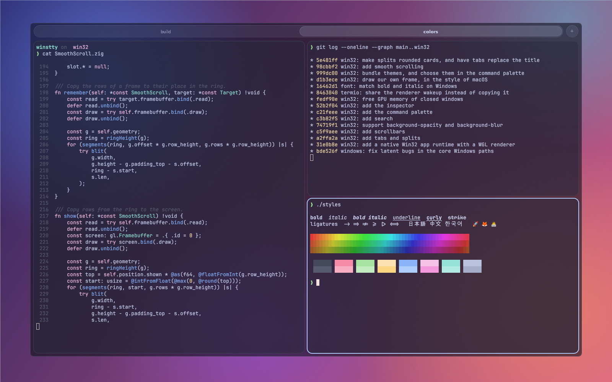

# winstty

[Ghostty](https://github.com/ghostty-org/ghostty) as a native Windows app.



This is an unofficial fork. It is not made or supported by the Ghostty project,
so please report problems here and not there.

## Features

- Pure Win32 and OpenGL, with no UI framework
- Tabs in a side panel or the title bar, and splits
- Glass, with `win32-glass`
- Splits and tabs that move rather than pop
- Command palette and scrollback search
- 900+ themes, with live preview in the command palette
- Smooth scrolling
- Ghostty's terminal inspector
- The same configuration file format as Ghostty

## Build

You need 64-bit Windows 11, [Git](https://git-scm.com) and
[Zig](https://ziglang.org/download/) 0.17.1.

```powershell
winget install --id Git.Git -e
winget install --id zig.zig -e --version 0.17.1
```

Open a new terminal, then:

```powershell
git clone --depth 1 -c core.longpaths=true https://github.com/tkuhemiya/winstty.git
cd winstty
zig build -Dtarget=x86_64-windows-gnu -Doptimize=ReleaseFast
.\zig-out\bin\ghostty.exe
```

The first build downloads its dependencies and takes a while. Keep `zig-out\share`
next to `zig-out\bin`, since it has the themes.

## Configure

Put your settings in `%LOCALAPPDATA%\ghostty\config.ghostty`. For example:

```ini
command = pwsh.exe -NoLogo
theme = Catppuccin Mocha
win32-glass = true
macos-window-buttons = hidden
```

These are only for Windows:

| Option | Default | |
| --- | --- | --- |
| `win32-glass` | `false` | Frosted glass. Replaces `background-opacity` and `background-blur`, which are ignored. Opaque if Windows can't show it. |
| `win32-glass-opacity` | `0.6` | From `0.2` to `1`. |
| `win32-glass-tint` | `theme` | Or a color. |
| `win32-tab-bar` | `side` | Or `top`, for tabs in the title bar. |
| `win32-animation` | `natural` | Or `snappy` or `off`. Always off if animation effects are turned off in Windows, under Accessibility, Visual effects. |
| `win32-smooth-scroll` | `true` | |

See the [Ghostty documentation](https://ghostty.org/docs/config) for the rest.
Not every option does something on Windows yet.

| Shortcut | Action |
| --- | --- |
| Ctrl+Shift+T | New tab |
| Ctrl+Shift+O / E | Split right / down |
| Ctrl+Shift+W | Close tab |
| Ctrl+Shift+P | Command palette |
| Ctrl+Shift+F | Search |

## License

[MIT](LICENSE), like Ghostty. Themes are from
[iTerm2-Color-Schemes](https://github.com/mbadolato/iTerm2-Color-Schemes)
([MIT](vendor/themes-LICENSE)).
